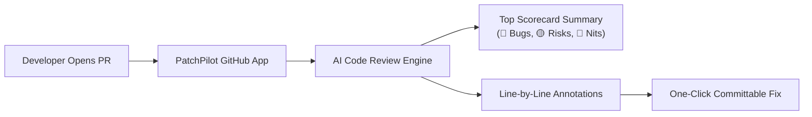

<p align="center">
  <a href="https://patchpilot.noventra.org.in" target="_blank" rel="noopener noreferrer">
    
  </a>
</p>

<p align="center">
  <strong>Bring-Your-Own-Key (BYOK) GitHub App for intelligent, automated Pull Request reviews.</strong>
</p>

<p align="center">
  <a href="https://patchpilot.noventra.org.in"></a>
  <a href="https://patchpilot.noventra.org.in/docs"></a>
  <a href="#supported-ai-providers"></a>
  <a href="#privacy--security"></a>
</p>

<p align="center">
  <a href="#why-patchpilot">Why PatchPilot</a> •
  <a href="#getting-started-in-3-steps">Get Started</a> •
  <a href="#how-it-works-in-your-prs">In Your PRs</a> •
  <a href="#interactive-chat-commands">PR Commands</a> •
  <a href="#supported-ai-providers">Supported Models</a> •
  <a href="#official-free-tier-models-catalog">Free Models</a> •
  <a href="#sequential-multi-key-failover-pipeline">Multi-Key Failover</a> •
  <a href="#privacy--security">Security & Privacy</a>
</p>

---

## Why PatchPilot?

Most AI code review tools charge expensive monthly subscriptions with strict token limits and markups. **PatchPilot** changes that:

- 💸 **Bring Your Own Key (BYOK)**: Use your existing API keys from Google Gemini, OpenAI, Groq, xAI, OpenRouter, or your own local Ollama instance. Pay raw inference cost—often pennies per month.
- 🔄 **Sequential Multi-Key Failover**: Automatically failover to secondary or tertiary backup models on rate limits (429), quota exhaustion (401/402/403), or provider outages (5xx).
- 👁️ **Persistent Masked Key Visibility**: Always see which keys and models are configured in your vault with secure masked previews (`gsk_9x••••••••a81b`).
- 🎯 **Line-Accurate Feedback**: Inline comments placed directly on the exact lines of changed code, not buried in generic pull request threads.
- ⚡ **One-Click Committable Fixes**: Review suggestions format directly as GitHub ` ```suggestion ` blocks. Accept code fixes with a single click.
- 💬 **Interactive Bot in PR Comments**: Ask `@patchpilot explain` or `@patchpilot fix` directly inside any review comment thread.
- 🛡️ **Zero-Knowledge Security Vault**: Your API keys are encrypted at rest with military-grade **AES-256-GCM**. Plaintext keys never touch logs or browser sessions.

---

## Getting Started in 3 Steps

You can set up PatchPilot on your repositories in under 2 minutes:

### 1. Sign In to the Dashboard
Visit **[patchpilot.noventra.org.in](https://patchpilot.noventra.org.in)** and click **Sign in with GitHub**.

### 2. Configure Your AI Provider Vault
- Select your preferred provider (e.g. Google Gemini, OpenAI, Groq, OpenRouter).
- Paste your API key and choose your target model (e.g. `gemini-2.0-flash`, `gpt-4o`, `llama-3.3-70b`).
- Click **Save Key to Vault** & test your connection with a single click.

### 3. Install the GitHub App on Your Repos
- Click **Install GitHub App** on your dashboard.
- Choose whether to grant access to all repositories or only specific projects.

🎉 **You are all set!** Whenever you open or update a Pull Request, PatchPilot will review your changes automatically.

---

## How It Works in Your PRs



When you open a PR, PatchPilot provides:

1. **Top-Level Scorecard**: A clear summary showing review status, key risks, and defect breakdown:
   - 🔴 **Bugs**: Potential null pointers, uncaught exceptions, and logical defects.
   - 🟡 **Risks**: Security gaps, performance bottlenecks, and concurrency concerns.
   - 🔵 **Nits**: Style improvements, naming clarity, and idiomatic practices.
2. **Inline Annotations**: Detailed feedback attached directly to relevant lines in the unified diff.
3. **Commit Suggestion Blocks**: Ready-to-merge patches formatted in standard GitHub suggestion blocks.

---

## Interactive Chat Commands

Have questions about a piece of code or want an alternative implementation? Mention PatchPilot in any PR review comment thread:

| Command | What it does | Example |
| :--- | :--- | :--- |
| `@patchpilot explain` | Breaks down logic, context, potential pitfalls, and edge cases | `@patchpilot explain how this token refresh logic handles expiration` |
| `@patchpilot fix` | Analyzes requested change and replies with a committable code suggestion | `@patchpilot fix handle the None case gracefully` |

> [!TIP]
> You can also use `@patchpilot-bot`, `/patchpilot`, or `/lens` as interchangeable aliases.

---

## Supported AI Providers

Plug in any of the following providers using your personal API key:

| Provider | Why Choose It | Recommended Models |
| :--- | :--- | :--- |
| **Google Gemini** | Generous free tier, ultra-fast latency, massive context window | `gemini-2.5-flash`, `gemini-2.5-pro` |
| **OpenAI** | Industry-standard reasoning and code synthesis | `gpt-4o`, `gpt-4o-mini`, `o3-mini` |
| **Groq Cloud** | Near-instant inference speed (~500+ tokens/sec) | `llama-3.3-70b-versatile`, `qwen-2.5-coder-32b` |
| **OpenRouter** | Access Claude 3.7 Sonnet, DeepSeek R1, and 100+ top models | `deepseek/deepseek-r1:free`, `meta-llama/llama-3.3-70b-instruct:free` |
| **xAI Grok** | Cutting-edge code comprehension and reasoning | `grok-2-1212`, `grok-beta` |
| **Ollama (Self-Hosted)** | 100% private and offline on your own GPU/workstation | `qwen2.5-coder:14b`, `deepseek-r1:14b` |

---

### Official Free-Tier Models Catalog

Zero-cost automated PR reviews with generous free quotas and 1-click dashboard presets:

| Provider | Model Identifier | Free Quota / Rate Limits | Get Free API Key |
| :--- | :--- | :--- | :--- |
| **Google AI Studio** | `gemini-2.5-flash` | 15 RPM, 1,000,000 TPM, 1,500 RPD | [Google AI Studio](https://aistudio.google.com/app/apikey) |
| **Google AI Studio** | `gemini-2.5-pro` | Deep reasoning, 2M context window | [Google AI Studio](https://aistudio.google.com/app/apikey) |
| **Groq Cloud** | `llama-3.3-70b-versatile` | 30 RPM, 6,000 TPM, ~300+ tok/s | [Groq Console](https://console.groq.com/keys) |
| **Groq Cloud** | `qwen-2.5-coder-32b` | Specialist coding architecture | [Groq Console](https://console.groq.com/keys) |
| **OpenRouter** | `deepseek/deepseek-r1:free` | 100% free community reasoning | [OpenRouter](https://openrouter.ai/keys) |
| **OpenRouter** | `meta-llama/llama-3.3-70b-instruct:free` | Flagship open weights | [OpenRouter](https://openrouter.ai/keys) |
| **Ollama** | `qwen2.5-coder:14b` | Unlimited local self-hosted | [Ollama Download](https://ollama.com) |

---

### Sequential Multi-Key Failover Pipeline

Never let a rate limit or upstream outage block your PR reviews:

1. **Persistent Key Visibility**: View saved keys at any time via safe masked previews (`gsk_9x••••••••a81b` or `ol••••••••` for local endpoints). Plaintext secrets are never stored unencrypted.
2. **Automatic Sequential Failover**: When your primary provider hits HTTP `401`, `402` (free quota exhausted), `403`, `404`, `429` (rate limit), `500/502/503/529`, or a network timeout, PatchPilot immediately tries your secondary and tertiary fallbacks in order.
3. **Sanitized PR Alerts**: If a fallback is used, the PR summary card alerts the team with a sanitized badge (e.g. `⚡ Failover Alert: Primary LLM returned Rate limit exceeded (429). Review successfully completed via fallback: Groq (llama-3.3-70b-versatile)`) without exposing raw request URLs or credentials.
4. **1-Click Promote-to-Primary**: Instantly swap any fallback to primary with a single click. The previous primary is automatically demoted into your fallback inventory.


---

## Privacy & Security

Your code and API credentials deserve complete privacy:

- 🔒 **AES-256-GCM Encryption**: Credentials are encrypted at rest using individual 12-byte initialization vectors (nonces) and a 256-bit master key.
- 🚫 **Zero Plaintext Exposure**: Plaintext API keys are never stored in databases, never rendered back to user browsers, and never output in server logs.
- 👥 **Strict Per-User Isolation**: Vault configurations are strictly bound to your authenticated GitHub account. No other user or repository can use or see your credentials.
- 📦 **No Data Harvesting**: Your source code is never used to train machine learning models. Diffs are processed strictly in ephemeral memory during review generation.

---

## Help & Documentation

- 🌐 **Live Web Application**: [https://patchpilot.noventra.org.in](https://patchpilot.noventra.org.in)
- 📖 **Interactive User Guide**: [https://patchpilot.noventra.org.in/docs](https://patchpilot.noventra.org.in/docs)
- 🐛 **Issue Tracker**: [GitHub Issues](https://github.com/89Aman/PatchPilot/issues)

---

<p align="center">
  Crafted with care by <a href="https://github.com/89Aman"><strong>89Aman</strong></a> for developers and open-source teams ❤️
</p>
